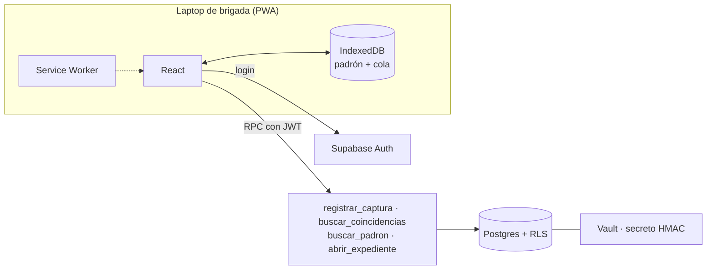

# BioBytes · Expediente único para brigadas de salud

**Reto 1 · EIRA Movimiento Rosa · Vibeathon Nerdearla México 2026**

BioBytes reconoce a la paciente que regresa, **nunca** fusiona expedientes por su cuenta y no pierde una captura aunque se caiga el internet. Busca por nombre (con o sin acentos), folio, CURP o teléfono; cuando encuentra expedientes parecidos explica por qué y deja que una persona decida.

> Solo datos ficticios. Este proyecto de hackatón **no** está autorizado para usarse con pacientes reales.

Producto, roles, pitch y modelo de negocio: [`docs/BioBytes.md`](docs/BioBytes.md) · Backlog de construcción: [`docs/BioBytes-Backlog.md`](docs/BioBytes-Backlog.md)

## Stack

| Capa | Tecnología |
|---|---|
| Front | React 19 + Vite + TypeScript + Tailwind CSS v4 |
| Offline | PWA (`vite-plugin-pwa` / Workbox) + IndexedDB (Dexie) |
| Datos | Supabase: Postgres + Auth + RLS + funciones RPC (`pg_trgm`, `unaccent`, `fuzzystrmatch`, `pgcrypto`, Vault) |
| Deploy | Vercel (sitio estático; `vercel.json` incluido) |

## Implementado vs. simulado

| Componente | Estado |
|---|---|
| Coincidencias en el servidor con confirmación humana («¿Es la misma persona?») | ✅ Implementado |
| Vínculo + teléfono/correo nuevos en una sola transacción | ✅ Implementado |
| Cronología con historial de cambios (valor anterior tachado) | ✅ Implementado |
| Sin conexión: PWA, padrón descargado, cola en IndexedDB, sincronización automática, coincidencias preliminares en el dispositivo | ✅ Implementado |
| Conflicto de versión con decisión campo por campo (panel «Por decidir») | ✅ Implementado |
| Roles Captura y Personal médico con RLS y revisión de rol en el servidor | ✅ Implementado |
| Bitácora encadenada con HMAC (secreto en Vault) + página de auditoría con «Verificar integridad» | ✅ Implementado |
| Idempotencia por `client_id` | ✅ En Postgres (`captura_sync`) |
| Valkey (idempotencia rápida y límite de intentos) | 🟡 Diseñado (BB-13); la idempotencia ya vive en Postgres |
| Cifrado AES-GCM de la cola local | 🟡 Diseñado (BB-10). Hoy la cola y el padrón local se **vacían** al cerrar sesión |
| Coordinación (fusionar/separar), Admin UI | 🟡 Diseñado; usuarios desde el panel de Supabase |
| Portal de paciente + SMS | 🔵 Diseñado |

## Cómo correrlo

1. **Supabase.** En un proyecto nuevo:
   - Corre en orden `supabase/migrations/*.sql` (SQL Editor o `supabase db push`).
   - Crea el secreto de la bitácora: `select vault.create_secret(encode(extensions.gen_random_bytes(32),'hex'), 'hmac_secret');`
   - En **Auth → Users** crea `captura@biobytes.demo`, `medico@biobytes.demo` y `auditor@biobytes.demo` (Auto confirm) y corre `supabase/seed.sql`.
   - En **Auth → Providers → Email** desactiva *Allow new users to sign up*.
   - Pruebas: `supabase/pruebas-bb03.sql` (T1–T5). Reinicio para la demo: `supabase/reinicio-demo.sql`.
2. **Front.**
   ```bash
   cp .env.example .env.local   # y llena VITE_SUPABASE_URL y VITE_SUPABASE_PUBLISHABLE_KEY
   npm install
   npm run dev                  # desarrollo (sin service worker)
   npm run build && npm run preview   # producción local, con modo sin conexión
   ```

Las contraseñas de los usuarios de prueba del proyecto de demo están en `supabase/usuarios-demo.local.txt` (ignorado por git).

## Deploy en Vercel

1. Importa el repo en Vercel (framework **Vite**; `vercel.json` ya define build, salida `dist` y la regla del SPA).
2. Variables de entorno: `VITE_SUPABASE_URL` y `VITE_SUPABASE_PUBLISHABLE_KEY`.
3. En Supabase → **Auth → URL Configuration**, agrega la URL de Vercel.

El modo sin conexión se prueba en la URL de producción: abre la app con red, inicia sesión, apaga el Wi-Fi y recarga.

## Arquitectura



- Toda escritura de identidad pasa por **una** función `security definer`: `registrar_captura`. El navegador nunca decide un vínculo.
- `pacientes`, `visitas`, `paciente_cambios` y `captura_sync` no tienen políticas RLS: no se leen ni escriben directo, solo vía RPC.
- Lo clínico vive en tablas aparte (`paciente_clinico`, `visita_nota`) con RLS solo para el rol médico.
- Abrir un expediente queda en la bitácora; la bitácora guarda ids, nunca nombres.

## Seguridad y privacidad

Matriz de roles completa en la §1.2 de `docs/BioBytes.md`. Verificado contra la base:

- Captura no ve antecedentes (`abrir_expediente` los devuelve como `null`; `paciente_clinico` le regresa 0 filas).
- Personal médico recibe **403 «No tienes permiso para registrar.»** al llamar a `registrar_captura`.
- `anon` no puede ejecutar ninguna función; `log_bitacora` no está expuesta a la API.

**Para un piloto real faltan:** análisis jurídico (LFPDPPP, NOM-004), revisión de seguridad independiente, decidir el hospedaje de datos de salud, cifrado de la cola local, capacitación y prueba de restauración de respaldos.

## Licencia

MIT
