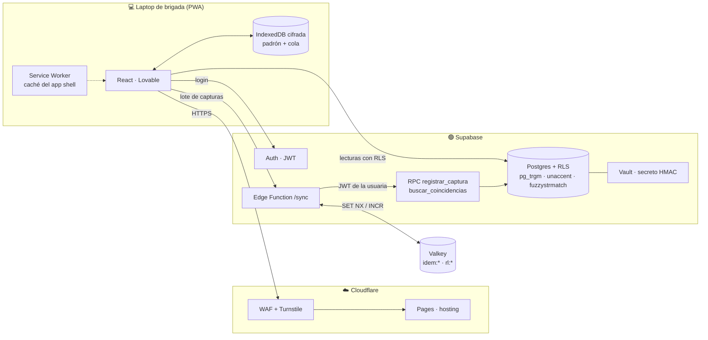
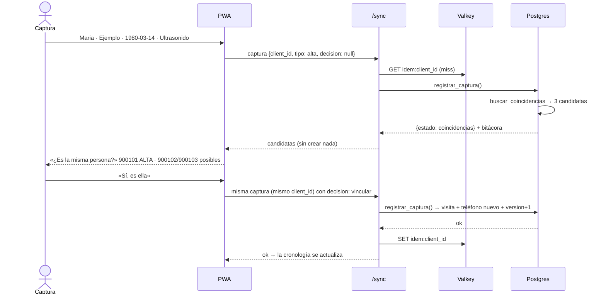
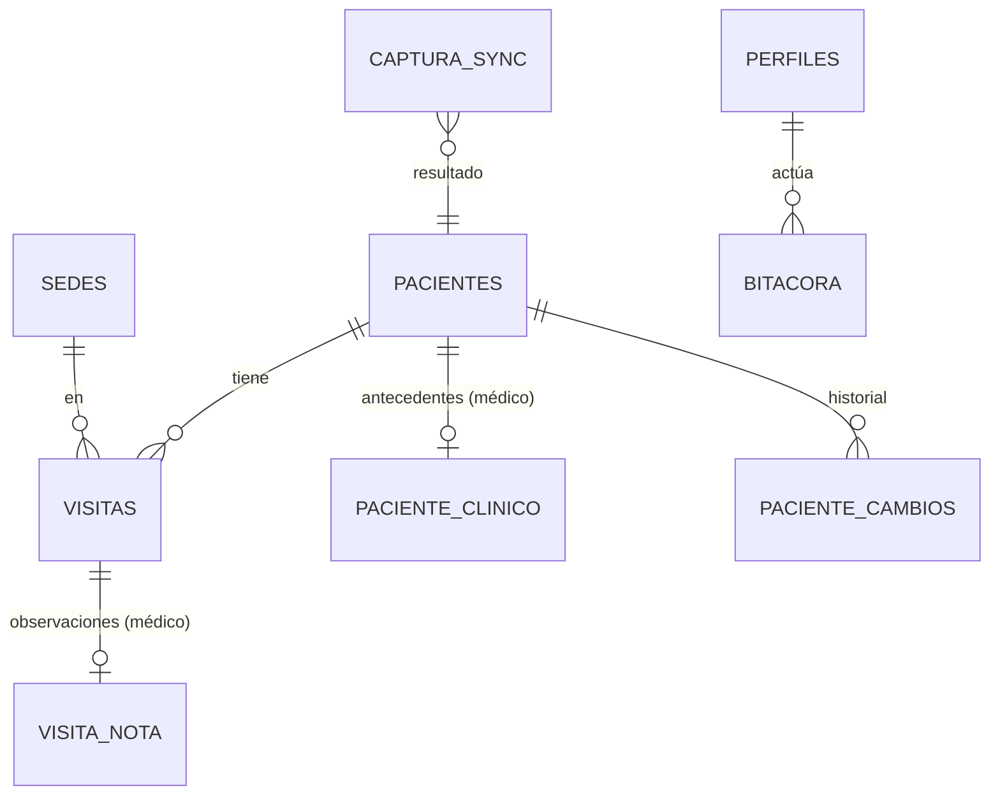
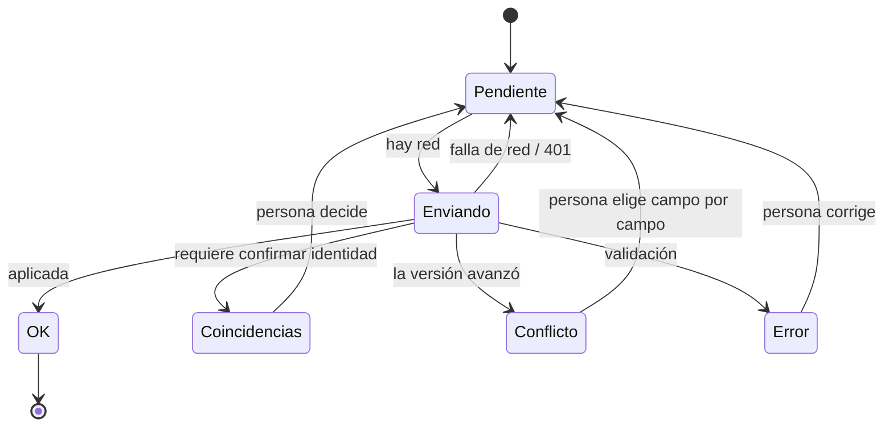

# BioBytes · Expediente único para brigadas de salud
**Reto 1 · EIRA Movimiento Rosa · Vibeathon Nerdearla México 2026**
Equipo: 1 persona · Stack: Lovable (front) · Supabase (Postgres + Auth + RLS) · Valkey (idempotencia y rate limit) · Cloudflare Pages (deploy)

> **Regla de oro del producto:** BioBytes reconoce a la paciente que regresa, **nunca** fusiona expedientes por su cuenta y no pierde una captura aunque se caiga el internet.

---

## Índice
0. Decisiones y supuestos
1. Perfiles y permisos
2. PRD (documento de requisitos de producto)
3. TRD (documento de requisitos técnicos)
4. Diagramas del backend
5. Landing principal (100 % México)
6. Paleta de colores y tipografía
7. Modelo de negocio
8. Pitch
9. Hoja de ruta en tickets
10. Implementado vs. simulado, y qué falta para un piloto
11. Preguntas abiertas para EIRA

---

## 0. Decisiones y supuestos

| # | Decisión | Por qué |
|---|---|---|
| D1 | Seis perfiles diseñados: Captura, Personal médico, Coordinación de jornada, Administración, Auditoría de privacidad, Paciente | Lo pidió el equipo. En la demo solo **Captura** y **Médico** funcionan de punta a punta; el resto se explica y se muestra en la matriz (ver §10) |
| D2 | Captura **escribe** antecedentes en el alta (vienen del formato en papel), pero después **solo el personal médico** los lee y edita | Minimizar exposición de datos de salud sin duplicar trabajo |
| D3 | Los datos clínicos van en **tablas separadas** (`paciente_clinico`, `visita_nota`) con su propia RLS | La privacidad por columna en Postgres es frágil; separar por tabla es simple y auditable |
| D4 | Toda operación que crea o vincula ocurre en **una sola función del servidor** (`registrar_captura`) | El navegador nunca decide un vínculo (corrige el punto 6 del primer intento) |
| D5 | Valkey solo se usa para **idempotencia rápida y límite de intentos**. La verdad vive en Postgres (`captura_sync.client_id` único) | Si Valkey falla, el sistema sigue funcionando |
| D6 | Cola offline **cifrada** (AES-GCM, WebCrypto) en IndexedDB y **borrada al cerrar sesión** | Supuesto: las laptops de brigada se comparten (pregunta abierta #4) |
| D7 | Fechas de día en `America/Mexico_City`, formato `AAAA-MM-DD` | Evita que una visita "caiga" en otro día por la zona del dispositivo |
| D8 | Licencia **MIT** para el repo | Pedido de licencia abierta; fácil de adoptar por otras OSC |

---

## 1. Perfiles y permisos

### 1.1 Fichas de perfil

**👩‍💻 Captura en brigada** (`captura`)
- *Quién es:* voluntaria o personal de EIRA en la mesa de registro de una jornada.
- *Contexto:* laptop compartida, señal intermitente, fila de pacientes, poca capacitación técnica.
- *Necesita:* encontrar rápido a la paciente, registrar la visita de hoy, actualizar el teléfono y no equivocarse de expediente.
- *Puede:* buscar, registrar paciente y visita, cambiar datos de contacto, confirmar o descartar coincidencias, resolver conflictos de sincronización, escribir antecedentes **solo en el alta**.
- *No puede:* leer antecedentes ni notas clínicas después de guardarlas, fusionar expedientes ya existentes, exportar con datos personales.

**🩺 Personal médico** (`medico`)
- *Quién es:* médica, enfermera o técnica que hace ultrasonido, Papanicolaou o exploración.
- *Necesita:* ver los antecedentes y la cronología completa antes de atender.
- *Puede:* ver padrón y expediente completos, leer y editar antecedentes, escribir notas clínicas en las visitas.
- *No puede:* dar de alta pacientes, vincular ni fusionar (eso es identidad, no clínica).

**🧭 Coordinación de jornada** (`coordinacion`)
- *Quién es:* responsable de una jornada o sede.
- *Necesita:* ver qué quedó pendiente de sincronizar, resolver duplicados y corregir errores de identidad.
- *Puede:* todo lo de Captura + **fusionar** dos expedientes duplicados y **separar** uno mal vinculado (siempre con confirmación y motivo), corregir nombre, fecha de nacimiento y CURP, ver el tablero de su jornada.
- *No puede:* leer datos clínicos ni gestionar usuarios.

**🛠️ Administración** (`admin`)
- *Quién es:* coordinación general o TI de EIRA.
- *Puede:* crear usuarios y asignar roles (nadie se asigna su propio rol), administrar catálogos (sedes, municipios, localidades, servicios), exportar datos operativos, lanzar y verificar respaldos.
- *No puede, por omisión:* leer datos clínicos. Si alguna vez lo necesita, tiene que asignarse temporalmente el rol médico, y eso queda en la bitácora.

**🔍 Auditoría de privacidad** (`auditor`)
- *Quién es:* responsable de protección de datos, o una persona externa de confianza.
- *Puede:* leer la bitácora (ids, no nombres), verificar la cadena de integridad (HMAC) y ver reportes de accesos.
- *No puede:* abrir expedientes ni modificar nada.

**🙋‍♀️ Paciente** (`paciente`, sin cuenta con contraseña)
- *Quién es:* la mujer atendida. Tiene su **tarjeta con folio** `EIRA-XXXXXX`.
- *Puede:* consultar su folio y su historial de visitas (fecha, sede y servicio) entrando con folio + fecha de nacimiento + código de un solo uso por SMS.
- *No puede:* ver notas clínicas ni resultados desde aquí (los resultados son el Reto 4), ni modificar datos.
- *Alternativa asistida:* si no tiene celular propio, la consulta se hace en la jornada con Captura.

### 1.2 Matriz de permisos (se revisa en el servidor con RLS y RPC)

| Acción | Captura | Médico | Coordinación | Admin | Auditor | Paciente |
|---|:-:|:-:|:-:|:-:|:-:|:-:|
| Buscar en el padrón y ver expediente (datos generales) | ✅ | ✅ | ✅ | ✅ | ❌ | solo el suyo |
| Registrar paciente y visita | ✅ | ❌ | ✅ | ❌ | ❌ | ❌ |
| Cambiar datos de contacto | ✅ | ❌ | ✅ | ❌ | ❌ | ❌ |
| Confirmar o descartar coincidencias | ✅ | ❌ | ✅ | ❌ | ❌ | ❌ |
| Resolver conflictos de sincronización | ✅ | ❌ | ✅ | ❌ | ❌ | ❌ |
| Corregir identidad (nombre, fecha de nacimiento, CURP) | ❌ | ❌ | ✅ | ❌ | ❌ | ❌ |
| Fusionar o separar expedientes | ❌ | ❌ | ✅ | ❌ | ❌ | ❌ |
| Escribir antecedentes | solo en el alta | ✅ | ❌ | ❌ | ❌ | ❌ |
| Leer y editar antecedentes | ❌ | ✅ | ❌ | ❌ | ❌ | ❌ |
| Escribir y leer notas clínicas de la visita | ❌ | ✅ | ❌ | ❌ | ❌ | ❌ |
| Exportar CSV operativo (sin datos personales) | ✅ | ✅ | ✅ | ✅ | ❌ | ❌ |
| Gestionar usuarios y catálogos | ❌ | ❌ | ❌ | ✅ | ❌ | ❌ |
| Leer la bitácora | ❌ | ❌ | su jornada | ✅ | ✅ | ❌ |
| Ver su propio historial de visitas | — | — | — | — | — | ✅ |

> Ocultar un botón no es seguridad: cada fila de la matriz corresponde a una política RLS o a una revisión de rol dentro de una función `security definer`.

---

## 2. PRD — Documento de requisitos de producto

### 2.1 Problema
En las jornadas de EIRA se llena un formato en papel y después se captura en Google Forms o Excel. La paciente se identifica **por nombre**: si una mujer acude cuatro veces en un año, puede quedar registrada cuatro veces. La señal en las comunidades es inestable, y el personal médico **necesita** ver los antecedentes en el momento de atender.

### 2.2 Objetivo
Reconocer a una paciente que regresa, conservar su historial de servicios y actualizar solo lo necesario, aun con conexión intermitente.

### 2.3 Usuarias y trabajos por hacer
| Perfil | "Cuando… quiero… para…" |
|---|---|
| Captura | Cuando llega una paciente, quiero saber en segundos si ya tiene expediente, para no registrarla otra vez |
| Médico | Cuando la atiendo, quiero ver sus visitas y antecedentes, para decidir bien sin repetir estudios |
| Coordinación | Al cerrar la jornada, quiero ver que todo se sincronizó y no hay duplicados, para entregar datos limpios |
| Paciente | Quiero que me reconozcan con mi tarjeta, para no dar mis datos cada vez |

### 2.4 Alcance del MVP (hackatón)
**Dentro**
1. Inicio de sesión con roles (usuarios sembrados, sin registro público).
2. Padrón con búsqueda por nombre (con o sin acentos), folio, CURP o teléfono; paginado en el servidor.
3. Alta + visita de hoy → búsqueda de coincidencias en el servidor → tarjeta «¿Es la misma persona?».
4. «Sí, es ella» vincula la visita **y aplica los datos de contacto nuevos** en una sola operación.
5. «Ninguna es ella» crea el expediente y registra qué candidatas se descartaron y quién.
6. Expediente con cronología (visitas y cambios; el valor anterior aparece tachado).
7. Modo sin conexión real: PWA con *service worker*, padrón descargado, cola cifrada, sincronización automática.
8. Conflicto de versión con decisión campo por campo.
9. Vista médica: cronología + antecedentes; sin botones de captura (y el servidor lo impide).
10. Bitácora encadenada con HMAC, visible para el auditor.

**Fuera (roadmap)**: portal de paciente con SMS, fusión y separación de expedientes, catálogos editables, integración con el Reto 4 (resultados de Papanicolaou), panel de coordinación.

### 2.5 Historias de usuaria y criterios de aceptación
| ID | Historia | Criterios de aceptación |
|---|---|---|
| H1 | Como Captura registro a una paciente nueva | Valida campos (§2.7); si no hay candidatas, crea el folio `EIRA-######` y la visita en una sola operación |
| H2 | Como Captura detecto que la paciente ya existe | Si hay ≥1 candidata, el servidor **no crea nada**, devuelve las candidatas con nivel y razones y lo registra en la bitácora |
| H3 | Como Captura confirmo que es ella | La visita se agrega al expediente; el teléfono y el correo nuevos se aplican como cambios con historial; la versión sube en 1 |
| H4 | Como Captura descarto candidatas | Se crea el expediente nuevo; la bitácora guarda los ids descartados; si la CURP ya existe se bloquea con el mensaje de §2.7 |
| H5 | Como Captura trabajo sin internet | Puedo abrir la app, buscar en el padrón descargado y capturar; la captura queda «Pendiente de sincronizar» y al volver la red se envía sola |
| H6 | Como Captura resuelvo un conflicto | Veo «Actual» y «Tu captura» por campo (por omisión «Actual») y elijo |
| H7 | Como Médico consulto antecedentes | Veo antecedentes y notas; no veo botones de alta, y si llamo la API de alta recibo 403 |
| H8 | Como Auditor verifico la bitácora | Un botón «Verificar integridad» recalcula la cadena y marca la primera fila alterada |
| H9 | Como cualquier usuaria cierro sesión | La cola y el padrón local se borran, o quedan cifrados con una llave que se destruye al salir |

### 2.6 Reglas de coincidencia (el corazón del reto)
1. Normalizar: minúsculas, sin acentos ni signos, espacios simples.
2. Preselección (máx. 50): misma CURP, o misma fecha de nacimiento, o mismo teléfono, o trigramas > **0.35** en nombre + primer apellido.
3. Similitud = 1 − Levenshtein ÷ longitud mayor; se toma la mayor entre «nombre completo» y «nombre + primer apellido».
4. Razones visibles: «Misma CURP», «Misma fecha de nacimiento», «Mismo teléfono», «Mismo nombre (sin acentos)», «Nombre parecido» (≥ 0.8), «Fecha de nacimiento distinta».
5. No es candidata si no coincide CURP, fecha ni teléfono y el nombre queda < 0.8.
6. **Alta** = misma CURP, o fecha + nombre ≥ 0.8, o teléfono + nombre ≥ 0.8. Lo demás es **posible**. *Ni siquiera «alta» decide sola.*
7. Orden: primero las de nivel alta; dentro de cada nivel, las que tengan más razones.

### 2.7 Validaciones y mensajes (las mismas en el front y en la base)
| Regla | Mensaje |
|---|---|
| Nombre obligatorio, hasta 100 caracteres | «Escribe el nombre.» |
| Primer apellido obligatorio | «Escribe el primer apellido.» |
| Fecha de nacimiento entre 1900-01-01 y hoy (CDMX) | «Fecha de nacimiento fuera de rango.» |
| CURP `^[A-Z]{4}\d{6}[HM][A-Z]{5}[A-Z0-9]\d$` | «CURP inválida (18 caracteres).» |
| Teléfono: 10 dígitos tras quitar lo demás | «El teléfono debe tener 10 dígitos.» |
| Fecha de visita ≤ hoy (CDMX) | «La fecha de la visita no puede ser futura.» |
| Sede de catálogo | «Elige la sede.» |
| Servicio de la lista | «Elige el servicio.» |
| Cambio sin diferencias | «No cambiaste ningún dato.» |
| CURP ya usada | «La CURP ya pertenece al expediente {folio}. Si es ella, vincula; si no, corrige la CURP.» |
| Sesión vencida al sincronizar | «Tu sesión expiró. Inicia sesión de nuevo; la captura sigue guardada en este dispositivo.» |

### 2.8 Principios de UX (que cualquiera lo pueda usar)
- **Busca antes de registrar:** la pantalla de inicio de Captura es una sola caja de búsqueda grande.
- **Un paso, una decisión:** tarjetas grandes con verbos claros («Sí, es ella: usar este expediente», «Ninguna es ella: crear expediente nuevo»).
- **Botones de 44 px como mínimo**, contraste AA, navegación completa con teclado.
- **Estado de conexión siempre visible** y anunciado a lectores de pantalla (`aria-live="polite"`).
- **«Requiere decisión» dice dónde se decide**: «Hay 1 captura por decidir → Abrir».
- **Lenguaje de México, sin tecnicismos**: «Sin internet», no «offline»; «Pendiente de enviar», no «en cola».
- **Contingencia:** botón «Imprimir formato en blanco» por si todo falla.

### 2.9 Métricas de éxito
| Métrica | Meta del piloto |
|---|---|
| Duplicados creados por jornada | < 1 % de las altas |
| Tiempo de identificación de una paciente recurrente | < 30 s |
| Capturas perdidas por falta de red | 0 |
| Capturas que requieren decisión humana | medir (línea base) |
| Accesos clínicos sin rol médico | 0 (verificado por bitácora) |

---

## 3. TRD — Documento de requisitos técnicos

### 3.1 Stack y papel de cada pieza
| Capa | Tecnología | Papel |
|---|---|---|
| Front | **Lovable** → React + Vite + TypeScript + Tailwind + shadcn/ui | UI. El código se sincroniza a GitHub |
| PWA | `vite-plugin-pwa` (Workbox) | Caché del *app shell* para abrir y navegar sin red |
| Almacén local | IndexedDB con **Dexie** | Padrón descargado (sin antecedentes) y cola de capturas |
| Cifrado local | WebCrypto AES-GCM 256 | Llave no extraíble por sesión; se destruye al cerrar sesión |
| Auth | Supabase Auth (correo + contraseña, usuarios sembrados) | JWT; el rol vive en la tabla `perfiles` |
| BD | Supabase Postgres + `pg_trgm`, `unaccent`, `fuzzystrmatch`, `pgcrypto` | Fuente de verdad, RLS y funciones RPC |
| Sync API | **Supabase Edge Function** `sync` (Deno) | Recibe lotes de la cola, consulta Valkey y llama a `registrar_captura` con el JWT de la usuaria |
| Caché / idempotencia | **Valkey** (gestionado: Aiven for Valkey, o un contenedor en Fly/Railway) | `SET NX` por `client_id` y límite de intentos por usuaria |
| Deploy | **Cloudflare Pages** (desde GitHub) + WAF/Turnstile en el login | Hosting estático global y gratuito |

> **Nota sobre Valkey en AWS:** ElastiCache Serverless for Valkey solo se alcanza desde dentro de una VPC, así que ni un Worker de Cloudflare ni una Edge Function lo ven directamente. Para el hackatón conviene un Valkey con endpoint TLS público (Aiven u otro); en producción, ElastiCache detrás de una Lambda o API Gateway. **Verifica la conexión TCP desde la Edge Function en los primeros 15 minutos**; si falla, desactiva Valkey con un *feature flag* y la idempotencia sigue en Postgres.

> **Tip de Lovable:** el *service worker* rompe la vista previa en iframe de Lovable. Regístralo **solo en producción** (`import.meta.env.PROD`) y prueba el modo sin conexión en la URL de Cloudflare.

### 3.2 Modelo de datos (SQL base)

```sql
-- Extensiones
create extension if not exists pg_trgm with schema extensions;
create extension if not exists unaccent with schema extensions;
create extension if not exists fuzzystrmatch with schema extensions;
create extension if not exists pgcrypto with schema extensions;

-- Normalización (wrapper inmutable para poder indexar)
create or replace function public.norm(t text) returns text
language sql immutable set search_path = public, extensions as $$
  select trim(regexp_replace(regexp_replace(lower(unaccent(coalesce(t,''))), '[^a-z0-9 ]', '', 'g'), '\s+', ' ', 'g'))
$$;

create type rol as enum ('captura','medico','coordinacion','admin','auditor');
create type servicio as enum ('papanicolaou','ultrasonido_mama','exploracion_mama','valoracion_nutricional','mastografia');
create type origen as enum ('en_linea','sin_conexion');

create table perfiles (
  user_id uuid primary key references auth.users on delete cascade,
  nombre text not null,
  rol rol not null,
  activo boolean not null default true
);

create table sedes (id serial primary key, nombre text not null, municipio text not null, localidad text, estado text not null default 'Jalisco');

create sequence folio_seq start 900104;
create table pacientes (
  id uuid primary key default gen_random_uuid(),           -- UUID v7 si hay extensión disponible
  folio text unique not null default 'EIRA-' || lpad(nextval('folio_seq')::text, 6, '0'),
  nombre text not null check (char_length(nombre) between 1 and 100),
  apellido_paterno text not null check (char_length(apellido_paterno) between 1 and 100),
  apellido_materno text,
  fecha_nacimiento date not null check (fecha_nacimiento >= '1900-01-01'),
  curp text unique check (curp ~ '^[A-Z]{4}\d{6}[HM][A-Z]{5}[A-Z0-9]\d$'),
  telefono text check (telefono ~ '^\d{10}$'),
  correo text,
  municipio text, localidad text,
  nombre_corto_norm text generated always as (norm(nombre || ' ' || apellido_paterno)) stored,
  nombre_completo_norm text generated always as (norm(nombre || ' ' || apellido_paterno || ' ' || coalesce(apellido_materno,''))) stored,
  version int not null default 1,
  client_id uuid unique,
  creado_por uuid references auth.users, creado_en timestamptz default now(), actualizado_en timestamptz default now()
);
create index on pacientes using gin (nombre_corto_norm gin_trgm_ops);
create index on pacientes (fecha_nacimiento);
create index on pacientes (telefono);

-- Clínico separado (RLS propia)
create table paciente_clinico (
  paciente_id uuid primary key references pacientes on delete cascade,
  antecedentes text, actualizado_por uuid, actualizado_en timestamptz default now()
);

create table visitas (
  id uuid primary key default gen_random_uuid(),
  paciente_id uuid not null references pacientes,
  fecha date not null,
  sede_id int not null references sedes,
  servicio servicio not null,
  origen origen not null default 'en_linea',
  client_id uuid unique,
  capturado_por uuid references auth.users, creado_en timestamptz default now()
);
create table visita_nota (            -- solo médico
  visita_id uuid primary key references visitas on delete cascade,
  observaciones text, autor uuid, creado_en timestamptz default now()
);

create table paciente_cambios (       -- historia, nunca se borra
  id bigserial primary key, paciente_id uuid references pacientes,
  campo text, valor_anterior text, valor_nuevo text,
  por uuid, en timestamptz default now()
);

create table captura_sync (           -- idempotencia (fuente de verdad)
  client_id uuid primary key, tipo text, paciente_id uuid, respuesta jsonb, en timestamptz default now()
);

create table bitacora (
  id bigserial primary key, usuario uuid, rol rol, accion text, entidad text, entidad_id uuid,
  detalle jsonb, en timestamptz default now(),
  hash_prev text, hash text not null
);
```

**Rol actual y RLS (extracto):**
```sql
create or replace function public.rol_actual() returns rol
language sql stable security definer set search_path = public as $$
  select rol from perfiles where user_id = auth.uid() and activo
$$;

alter table pacientes enable row level security;
create policy leer_padron on pacientes for select
  using (rol_actual() in ('captura','medico','coordinacion','admin'));
-- Sin políticas de insert/update: solo se escribe vía RPC security definer.

alter table paciente_clinico enable row level security;
create policy clinico_medico on paciente_clinico for all
  using (rol_actual() = 'medico') with check (rol_actual() = 'medico');
-- Captura escribe antecedentes solo dentro de registrar_captura (alta).

alter table visita_nota enable row level security;
create policy nota_medico on visita_nota for all
  using (rol_actual() = 'medico') with check (rol_actual() = 'medico');

alter table bitacora enable row level security;
create policy bitacora_lectura on bitacora for select using (rol_actual() in ('admin','auditor'));
```

**Búsqueda de coincidencias:**
```sql
create or replace function public.buscar_coincidencias(
  p_nombre text, p_ap1 text, p_ap2 text, p_fecha date, p_curp text, p_tel text)
returns table(paciente_id uuid, folio text, nombre_completo text, fecha_nacimiento date,
              municipio text, nivel text, razones text[])
language sql stable security definer set search_path = public, extensions as $$
with q as (
  select norm(p_nombre||' '||p_ap1) corto,
         norm(p_nombre||' '||p_ap1||' '||coalesce(p_ap2,'')) completo
), pre as (
  select p.* from pacientes p, q
  where (p_curp is not null and p.curp = upper(p_curp))
     or p.fecha_nacimiento = p_fecha
     or (p_tel is not null and p.telefono = p_tel)
     or similarity(p.nombre_corto_norm, q.corto) > 0.35
  limit 50
), sc as (
  select pre.*,
    greatest(
      1 - levenshtein(pre.nombre_corto_norm, q.corto)::numeric / greatest(length(pre.nombre_corto_norm), length(q.corto), 1),
      1 - levenshtein(pre.nombre_completo_norm, q.completo)::numeric / greatest(length(pre.nombre_completo_norm), length(q.completo), 1)
    ) sim,
    (p_curp is not null and pre.curp = upper(p_curp)) m_curp,
    (pre.fecha_nacimiento = p_fecha) m_fecha,
    (p_tel is not null and pre.telefono = p_tel) m_tel
  from pre, q
), r as (
  select sc.*,
    case when m_curp or (m_fecha and sim >= 0.8) or (m_tel and sim >= 0.8) then 'alta' else 'posible' end nivel,
    array_remove(array[
      case when m_curp then 'Misma CURP' end,
      case when m_fecha then 'Misma fecha de nacimiento' end,
      case when m_tel then 'Mismo teléfono' end,
      case when sim = 1 then 'Mismo nombre (sin acentos)' when sim >= 0.8 then 'Nombre parecido' end,
      case when sim >= 0.8 and not m_fecha then 'Fecha de nacimiento distinta' end
    ], null) razones
  from sc
  where m_curp or m_fecha or m_tel or sim >= 0.8
)
select id, folio, nombre||' '||apellido_paterno||coalesce(' '||apellido_materno,''),
       fecha_nacimiento, municipio, nivel, razones
from r
where rol_actual() in ('captura','coordinacion')
order by (nivel = 'alta') desc, cardinality(razones) desc;
$$;
```
Con la semilla de §4 del reto: «Maria Ejemplo, 1980-03-14» → `EIRA-900101` **alta** (misma fecha y mismo nombre); `EIRA-900102` posible (nombre parecido 0.87, fecha distinta); `EIRA-900103` posible (mismo nombre sin acentos, fecha distinta).

### 3.3 Función transaccional `registrar_captura(p jsonb)`
Pseudocódigo (plpgsql, `security definer`, una sola transacción):
```
1. r := rol_actual(); si r no está en (captura, coordinacion) → error 'forbidden'
2. si existe captura_sync(client_id) → devolver su respuesta guardada (idempotente)
3. según p.tipo:
   'alta':
     - validar (mismas reglas que el front)
     - si p.decision es nula:
         c := buscar_coincidencias(...)
         si c no está vacía → bitácora('coincidencias_detectadas', ids); devolver {estado:'coincidencias', candidatas:c}
     - si p.decision = 'vincular' (p.paciente_id):
         insertar visita (origen = p.origen)
         aplicar contacto nuevo (teléfono, correo) campo por campo → paciente_cambios, version + 1
         bitácora('vinculo_confirmado', {paciente_id, por})
     - si p.decision = 'nueva' (p.descartadas[]):
         si la CURP ya existe → error con folio
         insertar paciente, paciente_clinico (antecedentes), visita
         bitácora('alta', {paciente_id, descartadas})
   'visita': insertar visita (nunca entra en conflicto)
   'cambio':
     si pacientes.version != p.version_base → devolver {estado:'conflicto', servidor:{campos actuales}}
     si no hay diferencias → error 'No cambiaste ningún dato.'
     aplicar → paciente_cambios por campo, version + 1
4. guardar captura_sync(client_id, respuesta); devolver respuesta
```

### 3.4 Sincronización y modo sin conexión
- **Al iniciar sesión con red:** se descarga el padrón (folio, nombre, fecha, municipio, teléfono enmascarado, versión; **sin antecedentes**) a IndexedDB, cifrado.
- **Sin red:** la búsqueda corre en el dispositivo con la misma normalización + Levenshtein en JS (lógica espejo). Lo que encuentre se marca como **«coincidencia preliminar»**: la palabra final la tiene el servidor al sincronizar.
- **Cola:** cada captura lleva `client_id = crypto.randomUUID()`, tipo, payload cifrado, `version_base` y estado `pendiente | coincidencias | conflicto | error | ok`.
- **Envío:** en orden, en lotes de hasta 20, al evento `online` y cada 30 s. Un error de red detiene la cola sin perder nada. Un 401 deja la captura en la cola y muestra el aviso de sesión.
- **Fusión local:** varios cambios a la misma paciente sin red se juntan en una sola captura sobre la misma `version_base`.
- **Decisiones humanas:** si el servidor responde «coincidencias» o «conflicto», esa respuesta no se guarda como definitiva; la **misma** captura (mismo `client_id`) se reenvía con la decisión.
- **Llave de cifrado:** `CryptoKey` AES-GCM **no exportable** guardada en IndexedDB. Sobrevive a una recarga o a un reinicio (así no se pierden pendientes), pero no se puede copiar.
- **Cerrar sesión:** se borra la llave y se vacía IndexedDB. Si hay capturas pendientes se avisa: «Tienes 2 capturas sin enviar. Si sales, se perderán. Conéctate o pide a coordinación que las envíe».
- **Sesión sin red:** el token de Supabase dura alrededor de 1 hora y renovarlo requiere red. La app sigue funcionando con la sesión guardada; solo el envío espera. Al volver la red se llama a `refreshSession()` y, si falla, aparece el aviso de sesión vencida sin perder la captura.
- **Estado de conexión real:** `navigator.onLine` no basta (puede haber Wi-Fi sin internet). Se hace un `HEAD` a `/auth/v1/health` de Supabase cada 20 s.
- **Almacenamiento persistente:** `navigator.storage.persist()` para que el navegador no borre la cola si se queda sin espacio.
- **Padrón por jornada:** se descarga solo el municipio o la sede de la jornada, no todo el padrón: es más rápido y expone menos datos.
- **Pendiente con EIRA:** hoy el médico ve las visitas sin red, pero no los antecedentes. Si es indispensable, se descargan cifrados solo para la sesión médica y solo de las pacientes de la jornada.

### 3.5 Edge Function `sync` + Valkey (esquema)
```ts
// supabase/functions/sync/index.ts (Deno)
import { createClient } from "jsr:@supabase/supabase-js@2";
import { connect } from "https://deno.land/x/redis/mod.ts"; // Valkey habla el protocolo RESP

const valkey = await connect({ hostname: Deno.env.get("VALKEY_HOST")!, port: 6379, tls: true,
                               password: Deno.env.get("VALKEY_PASS") }).catch(() => null);

Deno.serve(async (req) => {
  const jwt = req.headers.get("Authorization")!;
  const sb = createClient(Deno.env.get("SUPABASE_URL")!, Deno.env.get("SUPABASE_ANON_KEY")!,
                          { global: { headers: { Authorization: jwt } } });
  const { data: { user } } = await sb.auth.getUser();
  if (!user) return new Response("unauthorized", { status: 401 });

  // Rate limit: 60 capturas por minuto por usuaria
  if (valkey) {
    const k = `rl:${user.id}:${Math.floor(Date.now() / 60000)}`;
    const n = await valkey.incr(k); if (n === 1) await valkey.expire(k, 60);
    if (n > 60) return new Response("too_many", { status: 429 });
  }
  const { capturas } = await req.json();
  const out = [];
  for (const c of capturas) {
    const cached = valkey && await valkey.get(`idem:${c.client_id}`);
    if (cached) { out.push(JSON.parse(cached)); continue; }           // camino rápido
    const { data, error } = await sb.rpc("registrar_captura", { p: c }); // la verdad: Postgres
    const res = error ? { client_id: c.client_id, estado: "error", mensaje: error.message } : data;
    if (valkey && !error) await valkey.set(`idem:${c.client_id}`, JSON.stringify(res), { ex: 86400 });
    out.push(res);
  }
  return Response.json({ resultados: out });
});
```

### 3.6 Bitácora encadenada
Un trigger `before insert` calcula `hash = encode(hmac(coalesce(hash_prev,'') || row_to_json(new)::text, secreto, 'sha256'), 'hex')`, con `hash_prev` = hash de la última fila. El secreto vive en Supabase Vault. La función `verificar_bitacora()` recorre la tabla y devuelve el primer id roto. El detalle guarda **ids, nunca nombres**.

### 3.7 Seguridad y privacidad
- Sin registro público (Auth: *disable signups*). Usuarios sembrados por el admin.
- Turnstile de Cloudflare en el login + límite de intentos en Valkey.
- La lista del padrón nunca manda antecedentes; los teléfonos van enmascarados en la lista (`33****1234`).
- Exportación CSV operativa: folio, municipio, localidad, servicio, fecha, sede, origen. Se neutralizan celdas que empiezan con `= + - @` (prefijo `'`).
- Abrir un expediente genera `bitacora('consulta_expediente')`.
- Datos ficticios únicamente. El hackatón **no** autoriza un despliegue con datos reales.

### 3.8 Operación, respaldo y costos
| Tema | Propuesta |
|---|---|
| Quién administra | Coordinación general de EIRA (rol admin) con un manual de una página |
| Capacitación | 30 min para Captura (buscar → decidir → registrar) y 15 min para Médico |
| Respaldo | Diario automático de Supabase (en plan Pro) + `pg_dump` semanal cifrado a Cloudflare R2 + export CSV operativo por jornada |
| Contingencia | Formato impreso en blanco descargable; la cola offline aguanta jornadas completas sin red |
| Costos estimados (verificar precios vigentes) | Cloudflare Pages: gratis · Supabase: gratis en el piloto, Pro ≈ 25 USD/mes en producción · Valkey gestionado: plan gratuito o ≈ 10–30 USD/mes · SMS para pacientes: costo por mensaje |
| Interoperabilidad | Export CSV/JSON abierto; en el roadmap, mapeo a FHIR `Patient` y `Encounter` |

---

## 4. Diagramas del backend

### 4.1 Arquitectura


### 4.2 Secuencia «María regresa»


### 4.3 Entidades


### 4.4 Estados de una captura en el dispositivo


---

## 5. Landing principal (100 % México)

**Tono:** cálido, cercano y comunitario, como EIRA. Español de México, inclusivo. Nada de «offline», «dashboard» ni «onboarding».

### Estructura y copy

**0 · Barra de navegación**
Logo BioBytes · Cómo funciona · Privacidad · Para quién · **[ Entrar ]** (arriba a la derecha, solo para quien ya usa la herramienta)

**1 · Hero**
> **Cada mujer, un solo expediente.**
> La herramienta para brigadas de salud que reconoce a cada paciente que regresa, en la sierra, en la colonia o en la plaza del pueblo, aunque no haya internet.
>
> ✓ **Encuentra sin duplicar:** busca por nombre, fecha de nacimiento, CURP o teléfono.
> ✓ **Tú decides:** BioBytes sugiere coincidencias, nunca une expedientes solo.
> ✓ **Funciona sin señal:** captura en campo y se sincroniza al volver la conexión.
> ✓ **Datos protegidos:** cada perfil ve solo lo que necesita.
>
> [ Ver demo en 2 minutos ]
>
> *Imagen:* mesa de registro en una jornada comunitaria, una laptop y la tarjeta con folio.
>
> *Nota de copy:* «expediente» se refiere al **registro e historial de visitas** de la paciente, no a un expediente clínico electrónico completo. No prometer más de eso en la landing.

**2 · El problema (tres tarjetas)**
- 📝 **Cuatro visitas, cuatro registros.** Hoy a la paciente se le identifica por su nombre, y «María López» puede ser muchas mujeres.
- 📶 **Sin señal no hay sistema.** En muchas comunidades el internet va y viene.
- 🔒 **Datos de salud en hojas de cálculo.** Información sensible sin control de quién la ve.

**3 · Cómo funciona (tres pasos)**
1. **Busca** con nombre, folio, CURP o teléfono, con o sin acentos.
2. **Confirma**: BioBytes sugiere y tú decides. Nunca une expedientes por su cuenta.
3. **Atiende**: la visita queda en su historial, con o sin internet.

**4 · Hecho para las jornadas en México**
- Funciona en las laptops que ya tienen, sin instalar nada.
- Folio `EIRA-######` en una tarjeta que la paciente conserva.
- CURP opcional: sirve para buscar, nunca es obligatoria para atender.
- Horario y fechas de la Ciudad de México; catálogo de municipios y localidades.
- Diseñado pensando en la protección de datos personales de salud. *(El detalle normativo, como LFPDPPP y NOM-004, va en la documentación técnica, no en la landing, para no dar a entender que ya cumple antes del análisis jurídico.)*

**5 · Privacidad por diseño**
Cada perfil ve solo lo que necesita. Los antecedentes clínicos solo los ve el personal médico. Cada consulta queda en una bitácora que nadie puede alterar sin que se note.

**6 · Impacto (con cifras de EIRA)**
EIRA ha acompañado a más de 40,000 mujeres y realizado 86,000 estudios desde Zapotlán el Grande, Jalisco. BioBytes existe para que ninguna de esas historias se pierda entre registros duplicados.

**7 · Para quién**
Organizaciones de la sociedad civil · DIF y gobiernos municipales · brigadas universitarias y de servicio social · clínicas comunitarias.

**8 · Llamado final**
> **Prevenir hoy para salvar vidas mañana, con datos que sí se encuentran.**
> [ Ver demo en 2 minutos ] · Código abierto en GitHub

**Footer:** «Un proyecto hermano de EIRA Movimiento Rosa A.C.» · Aviso de privacidad · Licencia MIT · Hecho en México 🇲🇽

---

## 6. Paleta de colores y tipografía

Propuesta de **marca hermana** de EIRA: conserva el rosa como ancla emocional (cáncer de mama, Movimiento Rosa) y suma un **verde jade** que comunica salud y confianza tecnológica y se lee bien sobre fondos claros. *Ajusta los tonos de rosa al manual de marca oficial de EIRA si lo tienen; el sitio público no expone sus códigos de color.*

| Token | Hex | Uso | Contraste |
|---|---|---|---|
| `--rosa-movimiento` | `#E0457B` | Acentos, ilustraciones, íconos grandes | Solo para texto grande o decorativo (≈ 3.6:1 con blanco) |
| `--rosa-profundo` | `#A8245A` | **Botón primario**, enlaces, foco | Blanco sobre él ≈ 7:1 ✅ AA/AAA |
| `--rosa-niebla` | `#FCE8EF` | Fondos de tarjetas y resaltados | — |
| `--jade` | `#1F7A6B` | Secundario: «En línea», confirmaciones | Blanco sobre él ≈ 5.3:1 ✅ |
| `--jade-claro` | `#E3F2EF` | Fondos de éxito | — |
| `--arena` | `#FAF6F1` | Fondo general (más cálido que el blanco) | — |
| `--tinta` | `#2B2230` | Texto principal | Sobre arena ≈ 15:1 ✅ |
| `--gris-suave` | `#6B6470` | Texto secundario | Sobre arena ≈ 5.5:1 ✅ |
| `--ambar` | `#B26A00` | Estado «Pendiente de sincronizar» | ✅ con blanco |
| `--rojo` | `#B42318` | Errores y conflictos | ✅ con blanco |
| `--azul-info` | `#2F5FA8` | Información y coincidencia «posible» | ✅ con blanco |

**Semántica de estados (siempre con ícono + texto, nunca solo color):**
- 🟢 En línea → jade · 🟠 Sin internet / Pendiente → ámbar · 🔴 Conflicto / Error → rojo
- Coincidencia **alta** → rosa profundo con la etiqueta «Muy probable» · **posible** → azul info con la etiqueta «Revisar»

**Tipografía:** *Nunito* (títulos, redondeada y cálida) + *Inter* (UI y datos). Base de 16 px, 18 px en la mesa de captura. Folios en `JetBrains Mono`.

```css
:root{
  --rosa-movimiento:#E0457B; --rosa-profundo:#A8245A; --rosa-niebla:#FCE8EF;
  --jade:#1F7A6B; --jade-claro:#E3F2EF; --arena:#FAF6F1; --tinta:#2B2230;
  --gris-suave:#6B6470; --ambar:#B26A00; --rojo:#B42318; --azul-info:#2F5FA8;
  --radio:14px; --toque-min:44px;
}
```

---

## 7. Modelo de negocio

BioBytes nace como **bien público digital** para EIRA y se sostiene ofreciendo lo mismo a otras organizaciones que hacen brigadas de salud en México.

### Lean Canvas
| Bloque | Contenido |
|---|---|
| **Problema** | Duplicados por identificar por nombre · captura doble papel→Excel · sin señal en campo · datos de salud sin control de acceso |
| **Segmentos** | 1) EIRA (usuaria ancla) · 2) OSC de salud con brigadas · 3) DIF y municipios que organizan jornadas · 4) brigadas universitarias y de servicio social |
| **Propuesta de valor** | «Cada mujer, un solo expediente, con o sin internet». Cero fusiones automáticas, privacidad por rol y bitácora verificable |
| **Solución** | PWA offline · coincidencias con confirmación humana · roles · bitácora HMAC · exportación abierta |
| **Canales** | Red de aliados de EIRA · convocatorias de fundaciones · vinculación con universidades (servicio social) · eventos de tecnología cívica |
| **Ingresos** | **Núcleo gratuito y abierto (MIT)** · **BioBytes Gestionado**: hosting, respaldos y soporte por organización (cuota mensual escalonada por número de jornadas) · **Implementación con municipios y DIF**: configuración de catálogos + capacitación (cuota única) · **Patrocinio RSE**: empresas aliadas financian la infraestructura de EIRA a cambio de reportes de impacto · **Donativos y convocatorias** de fundaciones de salud y tecnología |
| **Costos** | Infraestructura (≈ 50–100 USD/mes en producción, por validar) · SMS · soporte y capacitación · auditoría de seguridad y asesoría jurídica antes de producción |
| **Métricas clave** | Organizaciones activas · jornadas por mes · % de duplicados evitados · capturas offline sincronizadas sin pérdida |
| **Ventaja injusta** | Diseñado con y para una brigada real (EIRA) · caso de uso validado en campo · código abierto auditable |

### Precios hipotéticos (para validar)
| Plan | Para | Precio orientativo |
|---|---|---|
| Comunidad | Autohospedado, cualquier OSC | Gratis |
| Brigada | OSC pequeña, hasta 4 jornadas al mes | ≈ $990 MXN/mes |
| Red | OSC con varias sedes o un municipio | ≈ $2,900 MXN/mes |
| Implementación | Municipio o DIF | Cuota única por capacitación y configuración |
> EIRA, como organización ancla, lo usa sin costo; un aliado corporativo patrocina su infraestructura.

### Sinergia con los otros retos
BioBytes es el **expediente base**: el Reto 4 (entrega de resultados de Papanicolaou) se cuelga del folio, el Reto 3 (indicadores de impacto) separa personas únicas de servicios gracias al `paciente_id`, y el Reto 2 (jornadas con municipios) alimenta el catálogo de sedes.

---

## 8. Pitch

### Frase de 10 segundos
**«BioBytes le da a cada mujer un solo expediente que la reconoce cuando regresa, aunque no haya internet, sin que ninguna máquina decida por las personas.»**

### Guion para la demo de 2 minutos
| Tiempo | Qué se dice | Qué se ve |
|---|---|---|
| 0:00–0:15 | «María fue a cuatro jornadas de EIRA este año. Hoy tiene cuatro registros, porque se le busca por su nombre. Y en México hay muchas Marías.» | Landing: hero con los cuatro pilares |
| 0:15–1:00 | «Llega a su ultrasonido. Captura escribe "Maria", sin acento. BioBytes no crea nada: encuentra tres parecidas y explica por qué. Solo una tiene su misma fecha de nacimiento. La persona confirma, y la visita cae en su expediente.» | Alta → tarjeta «¿Es la misma persona?» → «Sí, es ella» → cronología |
| 1:00–1:20 | «Cambió de teléfono. Lo actualizamos y el anterior queda tachado en la historia: nada se borra.» | Cambio de contacto y cronología |
| 1:20–1:50 | «Ahora se va la señal.» *(apagar el Wi-Fi)* «La app abre, busca y captura. Pendiente de enviar.» *(prender el Wi-Fi)* «Y se sincroniza sola, marcada como capturada sin conexión.» | Barra «Sin internet» → «1 pendiente» → «En línea» → insignia |
| 1:50–2:00 | «La doctora ve los antecedentes; Captura no. Es real: Supabase, RLS, PWA y Valkey. Es simulado: SMS y portal de paciente. Para el piloto faltan una revisión jurídica y una de seguridad.» | Sesión del médico y diapositiva final |

### Diapositivas de apoyo (si se piden)
1. Problema · 2. Demo · 3. Cómo protegemos los datos (matriz de roles) · 4. Arquitectura · 5. Modelo de sostenibilidad · 6. Qué sigue para el piloto.

---

## 9. Hoja de ruta en tickets

> **La versión definitiva y ejecutable está en `BioBytes-Backlog.md`**, con SQL completo, prompts de Lovable por ticket, código de la cola offline, pruebas y cronograma. Esta sección queda como resumen.

### 9.1 Sprint Hackatón (una sola persona, ~2 h 20 min hasta la demo de las 15:30)
> Orden estricto. Si vas tarde, corta los tickets marcados ✂️. **Entrega en Devpost antes de las 16:00.**

| ID | Ticket | Criterio de aceptación | Tiempo | Depende de |
|---|---|---|---|---|
| **BB-01** | Crear el proyecto Supabase y correr el SQL de §3.2 (tablas, extensiones, `norm`, RLS) | Las tablas existen y `select norm('María  Ejempló')` devuelve `maria ejemplo` | 15 min | — |
| **BB-02** | Semilla: 3 pacientes ficticias del reto, 2 sedes, 1 visita de Papanicolaou en febrero de 2026 y 3 usuarios (captura@, medico@, auditor@) con su perfil | Login de cada usuario; `buscar_coincidencias('Maria','Ejemplo',null,'1980-03-14',null,null)` devuelve 900101 alta y las otras dos como posibles | 10 min | BB-01 |
| **BB-03** | `buscar_coincidencias` + `registrar_captura` (alta, vincular con contacto, nueva, visita, cambio con versión) | Casos de prueba en el SQL editor: no crea si hay candidatas; vincular aplica el teléfono; un cambio con versión vieja devuelve conflicto | 30 min | BB-02 |
| **BB-04** | Lovable: proyecto con el prompt maestro (§9.3), conectado a Supabase, login y layout con la barra de conexión | La app corre, el login funciona y la barra muestra «En línea» o «Sin internet» | 20 min | BB-01 |
| **BB-05** | Pantallas: Padrón (búsqueda), Alta + Servicio de hoy, tarjeta «¿Es la misma persona?», Expediente con cronología | Recorrido del paso 1 al 6 del reto en línea | 25 min | BB-03, BB-04 |
| **BB-06** | Cola offline: Dexie + `client_id` + envío por RPC al volver la red + estados | Wi-Fi apagado → captura «Pendiente» → Wi-Fi prendido → OK con insignia «sin conexión» | 20 min | BB-05 |
| **BB-07** | PWA: `vite-plugin-pwa`, registro solo en producción, deploy en Cloudflare Pages desde GitHub | Con la red apagada, al recargar la URL de Cloudflare la app abre | 10 min | BB-06 |
| **BB-08** | Vista médica: cronología + antecedentes; sin botones de captura | Logueado como médico, el RPC de alta devuelve error de permisos | 5 min | BB-05 |
| ✂️ **BB-09** | Edge Function `sync` + Valkey (idempotencia + rate limit) | Reenviar el mismo `client_id` devuelve la misma respuesta y queda marcado como *hit* en Valkey | 15 min | BB-06 |
| ✂️ **BB-10** | Cifrado AES-GCM de la cola + borrado al cerrar sesión | En DevTools, IndexedDB solo muestra texto cifrado; tras cerrar sesión, queda vacía | 10 min | BB-06 |
| ✂️ **BB-11** | Bitácora con trigger HMAC + página del auditor con «Verificar integridad» | Al alterar una fila a mano, la verificación la marca | 10 min | BB-01 |
| **BB-12** | README (implementado vs. simulado, cómo correrlo, licencia MIT), este `.md` como documento de arquitectura y video o ensayo de la demo | Repo público, Devpost enviado | 15 min | todo |

**Si te quedas sin tiempo:** sin BB-09 se usa RPC directo (la idempotencia la da `captura_sync` en Postgres) y Valkey se presenta como «diseñado, siguiente paso». Sin BB-10, se dice abiertamente en el README.

### 9.2 Después del hackatón (hacia el piloto)
| Fase | IDs | Tickets |
|---|---|---|
| **Fase 1 · Endurecer (2 semanas)** | BB-13…BB-20 | Conflicto campo por campo con UI completa · búsqueda offline en el dispositivo (Levenshtein en JS) · catálogos de sedes, municipios y localidades (INEGI) · corrección de identidad (Coordinación) · padrón paginado en el servidor · CSV seguro contra inyección · accesibilidad (44 px, `aria-live`, «Requiere decisión → Abrir») · zona horaria CDMX en todo |
| **Fase 2 · Coordinación y admin (2 semanas)** | BB-21…BB-27 | Rol Coordinación: tablero por jornada · **fusionar** expedientes con confirmación doble y motivo · **separar** un vínculo erróneo · Admin: gestión de usuarios y roles · respaldo automatizado a R2 + prueba de restauración documentada · formato impreso de contingencia |
| **Fase 3 · Paciente (2–3 semanas)** | BB-28…BB-32 | Tarjeta con folio y QR · portal de paciente (folio + fecha + OTP por SMS) · alternativa asistida en jornada · aviso de privacidad y consentimiento · enlace con el Reto 4 (resultados) |
| **Fase 4 · Piloto con EIRA (1 jornada real)** | BB-33…BB-38 | Análisis jurídico (LFPDPPP / NOM-004) · pentest y revisión de RLS · capacitación de 30 min · piloto paralelo al papel · medición de métricas §2.9 · retrospectiva |
| **Fase 5 · Escalar** | BB-39+ | Multi-organización (`org_id` en RLS) · export FHIR · plan Gestionado · documentación para otras OSC |

### 9.3 Prompt maestro para Lovable (copiar y pegar)
```
Construye "BioBytes", una PWA en español de México para brigadas de salud de EIRA Movimiento Rosa.
Stack: React + Vite + TS + Tailwind + shadcn/ui, conectada a mi Supabase (ya tiene tablas y RPC).
Diseño: cálido y accesible. Fondo #FAF6F1, texto #2B2230, primario #A8245A, secundario #1F7A6B,
acento #E0457B, pendiente #B26A00, error #B42318, info #2F5FA8. Fuentes: Nunito (títulos) e Inter.
Botones de 44px mínimo, radios de 14px, foco visible, contraste AA.

Pantallas:
1) Login (correo y contraseña de Supabase; sin registro). Tras el login, leer el rol de la tabla perfiles.
2) Layout con barra superior SIEMPRE visible: "En línea" (jade) / "Sin internet" (ámbar), con aria-live,
   contador "N pendientes de enviar" y "N por decidir → Abrir".
3) Padrón: una caja de búsqueda grande "Busca a la paciente antes de registrarla: por nombre (con o sin
   acentos), folio, CURP o teléfono". Tabla: folio, nombre, nacimiento, municipio, n.º de visitas, última visita.
4) Alta (solo rol captura): datos de la paciente (nombre, primer apellido, segundo apellido, fecha de
   nacimiento, CURP, teléfono, correo, municipio, antecedentes) con la nota "Con CURP o teléfono la búsqueda
   de coincidencias es más confiable." y la sección "Servicio de hoy" (fecha, sede, servicio) con la casilla
   "Registrar también la visita de hoy" marcada. Botón "Buscar coincidencias y registrar" que llama a
   rpc('registrar_captura', {p}) con client_id = crypto.randomUUID().
5) Si la respuesta es {estado:'coincidencias'}: tarjeta "¿Es la misma persona?" con el aviso
   "Encontramos expedientes parecidos. El nombre no basta para identificar: compara fecha de nacimiento,
   CURP y teléfono, y pregúntale a la paciente. Nada se fusiona sin tu confirmación." Cada candidata con
   su nivel ("Muy probable" para alta, "Revisar" para posible) y sus razones como chips. Botones
   "Sí, es ella: usar este expediente" y "Ninguna es ella: crear expediente nuevo".
6) Expediente: datos actuales + cronología (de lo más reciente a lo más antiguo) de visitas y cambios;
   cada cambio con el valor anterior tachado → nuevo; insignia "Capturada sin conexión". Si el rol es
   medico, mostrar antecedentes y notas; si es captura, NO mostrar antecedentes ni botones clínicos.
7) Cola offline con Dexie (IndexedDB): si no hay red, guardar la captura con estado 'pendiente' y
   enviarla en orden al evento 'online' y cada 30 s. Estados: pendiente, coincidencias, conflicto, error, ok.
   Al cerrar sesión, vaciar IndexedDB.
Todas las fechas en zona America/Mexico_City. Mensajes de validación exactamente así: [pegar la tabla §2.7].
```

---

## 10. Implementado vs. simulado, y qué falta para un piloto

| Componente | Estado en la demo |
|---|---|
| Coincidencias en el servidor con confirmación humana | ✅ Implementado |
| Vínculo + contacto nuevo en una transacción | ✅ Implementado |
| Cronología con historial de cambios | ✅ Implementado |
| Offline real (PWA + IndexedDB + sincronización) | ✅ Implementado |
| Roles Captura y Médico con RLS | ✅ Implementado |
| Valkey (idempotencia y rate limit) | ✅ si se completa BB-09; si no, 🟡 diseñado (la idempotencia vive en Postgres) |
| Cifrado de la cola | ✅ si se completa BB-10; si no, 🟡 diseñado |
| Bitácora HMAC + auditor | ✅ si se completa BB-11; si no, 🟡 diseñado |
| Coordinación (fusionar y separar), Admin UI | 🟡 Diseñado (matriz y tickets); los usuarios se gestionan desde el panel de Supabase |
| Portal de paciente + SMS | 🔵 Simulado o diseñado |
| Respaldo automatizado y restauración probada | 🔵 Descrito |

**Para un piloto real faltan:** análisis jurídico (aviso de privacidad, consentimiento, LFPDPPP, NOM-004), revisión de seguridad independiente, decidir el hospedaje de datos de salud (región y contrato), capacitación, prueba de restauración de respaldos y una jornada en paralelo con el papel.

---

## 11. Preguntas abiertas para EIRA
1. ¿Qué campos exactos del formato en papel son indispensables para identificar y atender?
2. ¿Confirman que Captura puede escribir antecedentes en el alta pero no leerlos después?
3. Si dos capturas sin conexión cambian el mismo expediente, ¿basta con que una persona decida campo por campo?
4. ¿Las laptops se comparten entre personas? (Define si basta con borrar la cola al salir o si hace falta cifrarla.)
5. ¿Ya existe una tarjeta o cartilla de EIRA donde pueda ir el folio?
6. ¿Quién sería la Coordinación de jornada y quién la persona responsable de los datos personales?
7. ¿Las pacientes tienen celular propio con SMS? ¿Qué porcentaje, aproximadamente?
8. ¿Tienen un manual de marca con colores oficiales para alinear la paleta?
